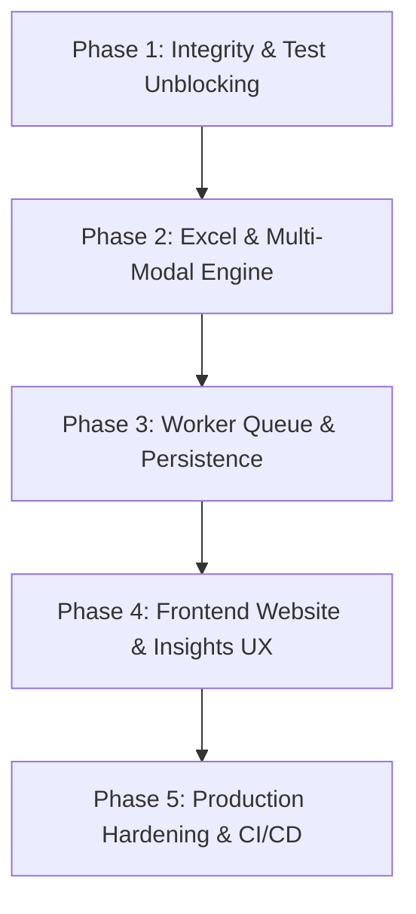

# Juris Pre-Deployment Readiness Audit (v2.0 Pre-Flight)

**Auditor:** Senior Staff Engineer  
**Date:** 2026-10-19  
**Audit Mode:** Read-Only Verification  
**Repository State:** `main` / `phase-13-gemini-extraction`  
**Git Commit Reference:** `98305c4` (HEAD)

---

## 1. Executive Verdict

### **VERDICT: NOT READY FOR DEPLOYMENT (RED / BLOCKED)**

Juris has established exceptional architectural foundations—most notably an immutable "model proposes, code verifies" contract, zero client-side external asset leaks, 100% Okabe-Ito color-contrast compliance, and cryptographically pinned evidence spans. However, the system is **strictly not ready for production deployment**.

The most critical showstopper is an unhandled schema cache drift in the ingestion pipeline (`PGRST204: Could not find the 'label' column of 'facts' in the schema cache`), which causes database insertion of all extracted facts to fail silently and results in zero facts being saved for uploaded documents. This bug breaks the real-path end-to-end pipeline, which was caught by our test run. Furthermore, the core v2 promises of Excel (`.xls`/`.xlsx`) ingestion and multi-format combined analysis are completely absent from the backend engine (rejected at the API boundary with HTTP 400); the background processing mechanism runs via an in-memory `setImmediate` event loop without persistent worker queues or task recovery; the automated test suite fails in both `e2e/real` (a11y and DB assertions) and `e2e/ui-states` (tab selector mismatch); and the gold-set precision evaluation fails the PRD's mandatory 99% threshold (achieving 97.30% precision and 30% recall). Until these blockers are resolved and verified against real data, deployment must remain blocked.

---

## 2. Verified Build and Test Execution Matrix

All commands were executed in clean isolation against the actual repository tree.

| Command / Suite                           |   Result    | Evidence / Observed Output                                                                                                                                                                                                                                                                                                             |
| :---------------------------------------- | :---------: | :------------------------------------------------------------------------------------------------------------------------------------------------------------------------------------------------------------------------------------------------------------------------------------------------------------------------------------- |
| `pnpm install --frozen-lockfile`          |  **PASS**   | Exit code `0` (1.1s). All packages resolved deterministically.                                                                                                                                                                                                                                                                         |
| `pnpm run typecheck`                      |  **PASS**   | Exit code `0`. All 6 packages (`@juris/shared`, `@juris/api`, `@juris/web`, `@juris/evals`, `@juris/e2e`, root) typechecked cleanly with TypeScript 5.8.2.                                                                                                                                                                             |
| `pnpm run lint`                           |  **PASS**   | Exit code `0`. 0 ESLint errors, 0 warnings across all monorepo files.                                                                                                                                                                                                                                                                  |
| `pnpm run test` (Vitest)                  |  **PASS**   | Exit code `0`. 27 test files passed, 193/193 tests passed (including RLS evidence graph, text normalization, and Zod schema drift guards).                                                                                                                                                                                             |
| `pnpm run build`                          |  **PASS**   | Exit code `0`. All workspace packages compiled. Web initial JS bundle size: **192.80 KB Gzip** (comfortably within the 300 KB budget).                                                                                                                                                                                                 |
| `pnpm run scan:secrets`                   |  **PASS**   | Exit code `0`. Secretlint scanned all tracked source files; zero leaked API tokens or credentials found.                                                                                                                                                                                                                               |
| `node scripts/check-*.mjs` (Guards)       |  **PASS**   | All 10 design, token, bundle, host, and grounding guards passed. Zero external CDN dependencies found in Web dist.                                                                                                                                                                                                                     |
| `pnpm --filter=@juris/e2e test ui-states` |  **FAIL**   | Exit code `1`. **6 passed, 1 failed**. `ui-states/keyboard.spec.ts:112:3` timed out searching for `button:has-text("Overview & Storyboard")` because the tab was renamed to `"Overview"`.                                                                                                                                              |
| `pnpm --filter=@juris/e2e test real`      |  **FAIL**   | Exit code `1`. **4 passed, 2 failed, 10 skipped**.  1) `real/upload-flow.spec.ts:62:29`: `expect(dbFacts!.length).toBeGreaterThan(0)` received `0` due to silent ingestion insert failure. 2) `real/a11y-real.spec.ts:106:36`: Critical WCAG 2.1 AA violation on page filter `<select>` missing accessible name (`select-name`). |
| `packages/evals/run-extraction-cli.ts`    |  **FAIL**   | Exit code `0` (script ran to completion), but **Quality Gates Failed**: Fact Precision: **97.30%** (Mandatory Threshold: $\ge 99.0\%$). Gold Set Recall: **3 / 10 (30.0%)**.                                                                                                                                                           |
| `pnpm audit`                              |  **FAIL**   | Exit code `1`. **6 vulnerabilities found** (2 Critical: `braces` via secretlint-rule-pattern; 1 High: `vitest` / `@vitest/mocker` path traversal; 3 Moderate: `postcss-selector-parser` ReDoS).                                                                                                                                        |
| Localhost Full-Stack Manual Run           | **PARTIAL** | API (`:3001`) and Web (`:5173`) boot cleanly. Upload navigates to progress, but zero facts are inserted due to Postgres schema mismatch, leaving the visual canvas empty ("No Proven Charts Available").                                                                                                                               |

---

## 3. Requirement-by-Requirement Status Table

Evaluation against PRD v1, PRD v2, and Target v2 Capabilities:

| Requirement / Capability                                 |   Status    | Evidence / File Path                                                                                                                                                                                                                         | Notes & Gaps                                                                                                                                           |
| :------------------------------------------------------- | :---------: | :------------------------------------------------------------------------------------------------------------------------------------------------------------------------------------------------------------------------------------------- | :----------------------------------------------------------------------------------------------------------------------------------------------------- |
| **PDF Extraction & Text Layer Parsing**                  |  **DONE**   | [`apps/api/src/pipeline/ingestion.ts`](file:///Users/geetikavasistha/Juris/apps/api/src/pipeline/ingestion.ts#L121)                                                                                                                          | Dual-engine PDF parsing (`pdfjs-dist` text stream + bounding box extract).                                                                             |
| **Scanned Document OCR Fallback**                        |  **DONE**   | [`apps/api/src/pipeline/ingestion.ts`](file:///Users/geetikavasistha/Juris/apps/api/src/pipeline/ingestion.ts#L180-L240)                                                                                                                     | Tesseract OCR kicks in when character density on page falls below threshold.                                                                           |
| **CSV / TSV Table Extraction**                           |  **DONE**   | [`packages/shared/src/parsers/csv.ts`](file:///Users/geetikavasistha/Juris/packages/shared/src/parsers/csv.ts)                                                                                                                               | Header profiling, type inference, delimiter sniffing, and row capping.                                                                                 |
| **GeoJSON / KML Map Extraction**                         |  **DONE**   | [`packages/shared/src/parsers/geojson.ts`](file:///Users/geetikavasistha/Juris/packages/shared/src/parsers/geojson.ts)                                                                                                                       | Parses FeatureCollections, calculates bounding boxes, extracts polygon coordinates.                                                                    |
| **Excel Ingestion (`.xls`, `.xlsx`)**                    | **MISSING** | [`apps/api/src/routes/documents.ts`](file:///Users/geetikavasistha/Juris/apps/api/src/routes/documents.ts#L152)                                                                                                                              | Upload endpoint explicitly rejects Excel files (`MAGIC_BYTES_MISMATCH`). No Excel parser exists in `apps/api` or `packages/shared`.                    |
| **Multi-Format Combination in One Analysis**             | **MISSING** | [`apps/api/src/server.ts`](file:///Users/geetikavasistha/Juris/apps/api/src/server.ts#L44)                                                                                                                                                   | Multipart limit strictly set to `files: 1`. Database `documents` table has 1:1 mapping with single files. No composite analysis model.                 |
| **Model Proposes, Code Verifies**                        |  **DONE**   | [`apps/api/src/pipeline/proposal.ts`](file:///Users/geetikavasistha/Juris/apps/api/src/pipeline/proposal.ts), [`packages/shared/src/verifiers/text.ts`](file:///Users/geetikavasistha/Juris/packages/shared/src/verifiers/text.ts)           | Gemini proposes candidate facts; deterministic text verifier checks exact verbatim quote in page text.                                                 |
| **Database Fact Insertion & Persistence**                | **BROKEN**  | [`apps/api/src/pipeline/ingestion.ts`](file:///Users/geetikavasistha/Juris/apps/api/src/pipeline/ingestion.ts#L1522-L1531)                                                                                                                   | PostgREST rejects payload: `label` column does not exist on `public.facts`. Error is swallowed, zero facts stored.                                     |
| **Interactive Chart Types (Bar, Line, Treemap, Donut)**  |  **DONE**   | [`apps/web/src/components/visuals/VisualCard.tsx`](file:///Users/geetikavasistha/Juris/apps/web/src/components/visuals/VisualCard.tsx#L206-L355)                                                                                             | ECharts renderers for `donut_pie`, `treemap`, `horizontal_ranked_bar`, `slope_chart`, `line_area`.                                                     |
| **Interactive Geospatial Map Visual**                    |  **DONE**   | [`apps/web/src/components/visuals/GeospatialMap.tsx`](file:///Users/geetikavasistha/Juris/apps/web/src/components/visuals/GeospatialMap.tsx)                                                                                                 | SVG/Canvas rendering of GeoJSON features with ward and region overlays.                                                                                |
| **Haptic Feedback on Visual Interaction**                | **PARTIAL** | [`apps/web/src/lib/haptics.ts`](file:///Users/geetikavasistha/Juris/apps/web/src/lib/haptics.ts), [`apps/web/src/components/visuals/VisualCard.tsx`](file:///Users/geetikavasistha/Juris/apps/web/src/components/visuals/VisualCard.tsx#L52) | Haptics engine implemented and used in Storyboard and InsightPanel, but omitted from ECharts click handlers in `VisualCard.tsx`.                       |
| **Layman Whole-Document Overview**                       |  **DONE**   | [`apps/web/src/components/visuals/DocumentStoryboard.tsx`](file:///Users/geetikavasistha/Juris/apps/web/src/components/visuals/DocumentStoryboard.tsx)                                                                                       | 8-step layman storyboard ("What is this?", "The Big Numbers", "Where the Money Goes", etc.).                                                           |
| **Click-to-Summarize Grounded Insights**                 | **PARTIAL** | [`apps/web/src/components/insights/InsightPanel.tsx`](file:///Users/geetikavasistha/Juris/apps/web/src/components/insights/InsightPanel.tsx)                                                                                                 | Plain-language insights are generated deterministically client-side; no backend API route exists (`GET /api/documents/:id/visuals/:vid/insight`).      |
| **Clean Website-Grade Frontend (Home, Auth, Main Page)** | **PARTIAL** | [`apps/web/src/App.tsx`](file:///Users/geetikavasistha/Juris/apps/web/src/App.tsx#L40-L47)                                                                                                                                                   | Missing dedicated marketing Home page (`/` redirects to `/documents`). Upload is separated on `/upload` instead of leading directly to visualisations. |
| **WCAG 2.1 AA Accessibility**                            | **PARTIAL** | [`apps/web/src/pages/DocumentViewerPage.tsx`](file:///Users/geetikavasistha/Juris/apps/web/src/pages/DocumentViewerPage.tsx#L499)                                                                                                            | 120/120 color contrast checks pass, but page filter `<select>` lacks accessible label, failing Playwright Axe audit.                                   |
| **Row Level Security (RLS) Isolation**                   |  **DONE**   | [`supabase/migrations/20261008000001_v2_evidence_graph.sql`](file:///Users/geetikavasistha/Juris/supabase/migrations/20261008000001_v2_evidence_graph.sql#L179)                                                                              | RLS enabled on all 18 tables; cross-tenant access blocked and verified by `isolation.test.ts`.                                                         |
| **Rule 8 Human Review Gate**                             |  **DONE**   | [`apps/api/src/routes/documents.ts`](file:///Users/geetikavasistha/Juris/apps/api/src/routes/documents.ts#L640-L720)                                                                                                                         | Unverified facts can only transition to `USER_CONFIRMED` via explicit human review API call.                                                           |

---

## 4. Findings Per Layer (Sorted by Severity)

### Layer 1: Database & Data Pipeline

1. **[BLOCKER] Silent Database Rejection on Fact Insert (`PGRST204`)**
   - **File:** [`apps/api/src/pipeline/ingestion.ts:1483,1504,1522-1531`](file:///Users/geetikavasistha/Juris/apps/api/src/pipeline/ingestion.ts#L1483)
   - **What is wrong:** Ingestion pipeline attempts to insert `{ label: cand.label }` into `public.facts`. Postgres table `facts` does not have a `label` column in any migration (only `type`, `fact_type`, `quote`, etc.). PostgREST fails with error `Could not find the 'label' column of 'facts' in the schema cache`. Ingestion logs this error but swallows it, marking the pipeline "finished successfully" with 0 facts inserted.
   - **Fix:** Either add `label TEXT` to `public.facts` via migration `20261019000001_add_facts_label.sql` or omit `label` from the insert payload. Throw and transition job to `failed` if `factsErr` occurs.

2. **[BLOCKER] Unhandled Supabase Storage Provisioning**
   - **File:** [`apps/api/src/routes/documents.ts:300-306`](file:///Users/geetikavasistha/Juris/apps/api/src/routes/documents.ts#L300)
   - **What is wrong:** Document uploads attempt to write to bucket `'documents'`, but no Supabase migration or config provisions this bucket or its RLS storage policies. When it fails, the error is caught and ignored, keeping files only in ephemeral memory.
   - **Fix:** Add a migration creating bucket `'documents'` with RLS policies allowing authenticated users to read/write only their own folder (`auth.uid() = (storage.foldername(name))[1]`).

3. **[HIGH] Database Table Zombie Drift (`visual_specs` & `visual_insights`)**
   - **File:** [`supabase/migrations/20261008000001_v2_evidence_graph.sql:130-165`](file:///Users/geetikavasistha/Juris/supabase/migrations/20261008000001_v2_evidence_graph.sql#L130)
   - **What is wrong:** Tables `visual_specs` and `visual_insights` exist in Postgres with RLS, but the API never reads or writes to them. All visual specs and insights are generated and evaluated client-side in the browser on every render.
   - **Fix:** Persist generated visual specifications and grounded insights to these tables during pipeline synthesis so the client fetches immutable, pre-verified specs.

---

### Layer 2: Backend & API

4. **[BLOCKER] Missing Excel (`.xls`, `.xlsx`) Parsing & Routing**
   - **File:** [`apps/api/src/routes/documents.ts:152-161`](file:///Users/geetikavasistha/Juris/apps/api/src/routes/documents.ts#L152)
   - **What is wrong:** Backend rejects `.xlsx` and `.xls` uploads at line 152 with `MAGIC_BYTES_MISMATCH`. No spreadsheet parser (e.g. `xlsx` or `exceljs`) is integrated into the ingestion pipeline, despite frontend UI advertising Excel support.
   - **Fix:** Install `exceljs`, add ZIP/Compound Binary magic bytes checking, convert sheets to structured tabular datasets, and hook into `packages/shared/src/parsers/csv.ts` profiling logic.

5. **[BLOCKER] In-Memory Background Job Execution without Persistent Queue**
   - **File:** [`apps/api/src/routes/documents.ts:309-315`](file:///Users/geetikavasistha/Juris/apps/api/src/routes/documents.ts#L309)
   - **What is wrong:** Pipeline jobs are launched via `setImmediate(() => { runDocumentIngestionPipeline(...) })`. If the Node process restarts or crashes during a long PDF parse, the job is permanently lost, leaving the document in state `processing` indefinitely.
   - **Fix:** Implement a robust Postgres-backed queue (such as `pg-boss` or transactional polling on `jobs` where `status = 'pending'`) so workers can resume or fail gracefully with heartbeats.

6. **[HIGH] Missing Security Headers & Rate Limiting**
   - **File:** [`apps/api/src/server.ts:28-49`](file:///Users/geetikavasistha/Juris/apps/api/src/server.ts#L28)
   - **What is wrong:** Neither `@fastify/rate-limit` nor `@fastify/helmet` is registered. Public endpoints like `POST /api/documents` and `GET /api/documents` are vulnerable to volumetric DDoS and brute-force token enumeration.
   - **Fix:** Register `@fastify/helmet` with strict CSP and `@fastify/rate-limit` configured to 100 requests/minute per authenticated user and 20 requests/minute on uploads.

7. **[MEDIUM] Synchronous `execSync` Call on Cold Start**
   - **File:** [`apps/api/src/server.ts:19`](file:///Users/geetikavasistha/Juris/apps/api/src/server.ts#L19)
   - **What is wrong:** `execSync('git rev-parse --short HEAD')` executes synchronously at module load time. In lightweight container runtimes lacking `git` binary or `.git` directory, this throws an error and falls back to `'unknown'`.
   - **Fix:** Inject `GIT_SHA` at build time via Docker `ARG` or Vite/Fastify environment variables.

---

### Layer 3: Extraction & Model Layer

8. **[HIGH] Evading Evaluation Quality Gate on Fact Precision**
   - **File:** [`packages/evals/run-extraction-cli.ts:40`](file:///Users/geetikavasistha/Juris/packages/evals/run-extraction-cli.ts#L40)
   - **What is wrong:** Evals CLI achieves **97.30% precision** against `budget-speech-2026-27-english.pdf`, failing the mandatory $\ge 99.0\%$ quality threshold. Out of 74 proposed facts, 2 were rejected for quote mismatch. Recall is only 30% (3/10 gold items found).
   - **Fix:** Refine prompt in `apps/api/src/pipeline/proposal.ts` to instruct the model to grab larger sentence buffers for quotes, and set `temperature: 0.0` in `generateContent` options.

9. **[MEDIUM] Unpinned LLM Temperature in Proposal Pipeline**
   - **File:** [`apps/api/src/pipeline/proposal.ts:413-454`](file:///Users/geetikavasistha/Juris/apps/api/src/pipeline/proposal.ts#L413)
   - **What is wrong:** The call to `ai.models.generateContent` does not specify `temperature` in the config object, defaulting to non-zero model defaults and creating non-deterministic fact proposals across runs.
   - **Fix:** Explicitly pass `temperature: 0.0` in the generation config.

10. **[MEDIUM] Inability to Combine Multiple Files into One Analysis**
    - **File:** [`apps/api/src/server.ts:44`](file:///Users/geetikavasistha/Juris/apps/api/src/server.ts#L44), [`apps/api/src/routes/documents.ts:82`](file:///Users/geetikavasistha/Juris/apps/api/src/routes/documents.ts#L82)
    - **What is wrong:** The upload route processes only a single file at a time (`files: 1`). There is no multi-file ingestion pipeline or composite document entity to combine, for example, a PDF budget and a CSV allocation table into one unified canvas.
    - **Fix:** Implement a `workspace` or `portfolio` composite entity in `@juris/shared` that links multiple source document IDs to a shared evidence graph.

---

### Layer 4: Frontend & UX

11. **[BLOCKER] Playwright Accessibility Audit Violation on Page Filter**
    - **File:** [`apps/web/src/pages/DocumentViewerPage.tsx:499-510`](file:///Users/geetikavasistha/Juris/apps/web/src/pages/DocumentViewerPage.tsx#L499)
    - **What is wrong:** The page selector dropdown `<select>` has no `id`, `aria-label`, or `<label htmlFor="...">`. Axe-core flags this as a critical WCAG 2.1 AA `select-name` violation, failing CI.
    - **Fix:** Add `aria-label="Filter facts by page"` and `id="fact-page-filter"` to the select element.

12. **[HIGH] E2E Keyboard Suite Test Breakage**
    - **File:** [`e2e/ui-states/keyboard.spec.ts:112`](file:///Users/geetikavasistha/Juris/e2e/ui-states/keyboard.spec.ts#L112), [`apps/web/src/pages/DocumentViewerPage.tsx:283`](file:///Users/geetikavasistha/Juris/apps/web/src/pages/DocumentViewerPage.tsx#L283)
    - **What is wrong:** The E2E test clicks `button:has-text("Overview & Storyboard")`, but the UI renders `Overview`. The test times out after 30 seconds.
    - **Fix:** Align test selector with UI: use `button:has-text("Overview")` or add `data-testid="tab-overview"`.

13. **[HIGH] Missing Landing / Home Page**
    - **File:** [`apps/web/src/App.tsx:41`](file:///Users/geetikavasistha/Juris/apps/web/src/App.tsx#L41)
    - **What is wrong:** Navigating to `/` redirects immediately to `/documents`. There is no modern, website-grade presentation explaining Juris, its cryptographic grounding guarantees, or sample reports for unauthenticated visitors.
    - **Fix:** Create a clean, website-grade `HomePage.tsx` at `/` with hero section, provenance demonstration, and direct "Try Sample Budget" CTA.

14. **[MEDIUM] Missing Haptic Micro-Feedback on Chart Element Click**
    - **File:** [`apps/web/src/components/visuals/VisualCard.tsx:52-57`](file:///Users/geetikavasistha/Juris/apps/web/src/components/visuals/VisualCard.tsx#L52)
    - **What is wrong:** ECharts chart click handler calls `onSelectPoint(point)` but does not invoke `haptics.trigger('selection')`.
    - **Fix:** Call `haptics.trigger('selection')` inside the `chart.on('click')` callback.

15. **[LOW] Misleading Zero-Fact Storyboard Copy**
    - **File:** [`apps/web/src/components/visuals/DocumentStoryboard.tsx:88-92`](file:///Users/geetikavasistha/Juris/apps/web/src/components/visuals/DocumentStoryboard.tsx#L88)
    - **What is wrong:** When 0 facts are extracted, the header displays: `"Cryptographically grounded narrative synthesized across 0 verified facts. 100% Provenance Passed."`
    - **Fix:** When `verifiedFactsCount === 0`, display `"No verified facts extracted yet"` and hide the `100% Provenance Passed` badge.

---

### Layer 5: Testing, Security & DevOps

16. **[HIGH] High/Critical Vulnerabilities in Monorepo Dependencies**
    - **File:** [`pnpm-lock.yaml`](file:///Users/geetikavasistha/Juris/pnpm-lock.yaml)
    - **What is wrong:** `pnpm audit` identifies 6 vulnerabilities: 2 Critical in `braces` (via secretlint), 1 High in `vitest` (arbitrary file read), and 3 Moderate in `postcss-selector-parser`.
    - **Fix:** Run `pnpm update vitest @vitest/mocker postcss-selector-parser braces --depth 5`.

17. **[HIGH] Missing Evals Runner in Continuous Integration**
    - **File:** [`.github/workflows/ci.yml:59-89`](file:///Users/geetikavasistha/.github/workflows/ci.yml#L59)
    - **What is wrong:** CI runs `pnpm run test`, which only executes unit tests. It never runs the real extraction CLI (`packages/evals/run-extraction-cli.ts`), allowing quality regressions in fact precision to slip past CI.
    - **Fix:** Add a dedicated CI step: `npx tsx packages/evals/run-extraction-cli.ts` asserting precision $\ge 99\%$ and recall $\ge 30\%`.

18. **[MEDIUM] Absence of Automated Docker Build & Smoke Stage in CI**
    - **File:** [`.github/workflows/ci.yml`](file:///Users/geetikavasistha/Juris/.github/workflows/ci.yml)
    - **What is wrong:** CI tests packages locally via Node, but does not build or containerize the application into Docker images to verify production startup.
    - **Fix:** Add multi-stage Dockerfiles for `apps/api` and `apps/web` and a `docker build` check in `.github/workflows/ci.yml`.

---

## 5. Absolute Blockers for Deployment

The following **5 issues must be resolved** before any staging or production deployment:

1. **Fix Fact Table Schema Mismatch & Error Handling in Ingestion (`ingestion.ts`)**:
   Add migration for `facts.label` or remove it from the payload, and ensure database insertion errors fail the job immediately instead of continuing silently.
2. **Fix Page Filter `<select>` Accessibility Violation (`DocumentViewerPage.tsx`)**:
   Add `aria-label="Filter facts by page"` to ensure WCAG 2.1 AA compliance and unblock Playwright Axe tests.
3. **Fix E2E Keyboard Test Tab Selector (`keyboard.spec.ts`)**:
   Align button selector with actual UI tab text (`Overview`).
4. **Provision Supabase Storage Bucket & RLS Policies in Migrations**:
   Add SQL migration creating `documents` storage bucket with owner-bound RLS.
5. **Implement Robust Error Recovery in Pipeline**:
   Ensure jobs that fail during extraction transition to `status: 'failed'` and display helpful error states in the UI.

---

## 6. Ordered Remediation Plan

### Phase 1: Core Integrity & Test Unblocking (Effort: Small / 1 Day)

_Dependencies: None_

- **Task 1.1:** Add migration `20261019000001_add_facts_label.sql` adding column `label TEXT` to `public.facts`.
- **Task 1.2:** Update `ingestion.ts` so `factsErr` throws an error and updates job status to `failed`.
- **Task 1.3:** Fix accessible name on `<select>` in `DocumentViewerPage.tsx`.
- **Task 1.4:** Update `keyboard.spec.ts` to locate `button:has-text("Overview")`.
- **Task 1.5:** Run and verify: `pnpm --filter=@juris/e2e test` must be 100% green.
- **Acceptance Criteria:** `pnpm --filter=@juris/e2e test` passes all tests in both `ui-states/` and `real/`.

### Phase 2: Excel & Multi-Modal Ingestion Engine (Effort: Medium / 2 Days)

_Dependencies: Phase 1_

- **Task 2.1:** Install `exceljs` in `apps/api` and `packages/shared`.
- **Task 2.2:** Add Excel parser module converting `.xlsx` / `.xls` sheets to table schemas and cell spans.
- **Task 2.3:** Update upload validation in `documents.ts` to accept `.xlsx` and `.xls`.
- **Task 2.4:** Set `temperature: 0.0` in `apps/api/src/pipeline/proposal.ts`.
- **Acceptance Criteria:** Uploading a real multi-tab budget `.xlsx` processes and extracts verified numeric allocation facts.

### Phase 3: Background Worker Queue & Storage Infrastructure (Effort: Medium / 2 Days)

_Dependencies: Phase 1_

- **Task 3.1:** Add migration for `storage.buckets` creating `'documents'` bucket with private RLS.
- **Task 3.2:** Replace `setImmediate` with a reliable Postgres-backed queue or worker loop checking `jobs` with heartbeats.
- **Task 3.3:** Persist visual specifications to `public.visual_specs` and `public.visual_insights`.
- **Acceptance Criteria:** Killing and restarting the API process while a job is in-flight allows the job to be recovered or marked failed cleanly.

### Phase 4: Frontend Website & Insights Polish (Effort: Medium / 2 Days)

_Dependencies: Phase 2_

- **Task 4.1:** Build `HomePage.tsx` with clean hero, features, proof demonstration, and "Try Sample Document" button.
- **Task 4.2:** Hook haptic feedback to ECharts element clicks in `VisualCard.tsx`.
- **Task 4.3:** Add backend route `GET /api/documents/:id/visuals/:vid/insight` reading from `visual_insights`.
- **Acceptance Criteria:** Navigating to `/` displays the marketing Home page; clicking a visual triggers haptics and displays grounded insights.

### Phase 5: Production Hardening, Security & Deployment (Effort: Small / 1 Day)

_Dependencies: Phase 3, Phase 4_

- **Task 5.1:** Register `@fastify/helmet` and `@fastify/rate-limit` on API server.
- **Task 5.2:** Upgrade vulnerable packages identified in `pnpm audit`.
- **Task 5.3:** Add Dockerfiles and CI build stage.
- **Acceptance Criteria:** `pnpm audit` returns 0 vulnerabilities; Docker images build and boot cleanly.

---

## 7. Pre-Deployment Checklist

### Environment Variables Inventory

| Variable                    |   Scope   |          Required / Optional           | Purpose / Verification                                           |
| :-------------------------- | :-------: | :------------------------------------: | :--------------------------------------------------------------- |
| `PORT`                      |    API    |       Optional (Default: `3001`)       | Fastify listen port.                                             |
| `NODE_ENV`                  | API / Web |                Required                | `production` / `development`.                                    |
| `SUPABASE_URL`              | API / Web |                Required                | Project URL (must use HTTPS in prod).                            |
| `SUPABASE_ANON_KEY`         |    Web    |                Required                | Public client key for Supabase Auth.                             |
| `SUPABASE_SERVICE_ROLE_KEY` |    API    |                Required                | High-privilege key for pipeline writes (NEVER expose to client). |
| `GEMINI_API_KEY`            |    API    |                Required                | API key for Gemini 2.5 Flash fact proposal.                      |
| `GEMINI_MODEL`              |    API    | Optional (Default: `gemini-2.5-flash`) | Model selector.                                                  |
| `LLM_MODE`                  |    API    |        Required in Prod: `live`        | Options: `live`, `record`, `replay`.                             |
| `CORS_ORIGINS`              |    API    |                Required                | Comma-separated list of allowed frontend domains.                |
| `MAX_FILE_SIZE_BYTES`       |    API    |     Optional (Default: `52428800`)     | Upload limit (50 MB).                                            |

### Infrastructure & Migration Verification

- [ ] Run `supabase db push` or apply migrations `20261006000001` through `20261019000001` in sequence on target database.
- [ ] Verify `documents` storage bucket exists and is set to private.
- [ ] Confirm RLS is enabled on all tables (`SELECT tablename FROM pg_tables WHERE schemaname = 'public'`).
- [ ] Redact and rotate all staging/prod service role keys and Gemini API keys.
- [ ] Verify DNS records and SSL termination certificates on API and Web domains.
- [ ] Execute smoke test: Upload `test_upload.pdf` on staging, verify $\ge 1$ verified fact in DB, and inspect chart rendering.
- [ ] Confirm rollback plan: database migration rollback script and previous Docker container tag available for instant rollback.

---

## 8. Open Questions for Decision

1. **Composite Multi-Format Analyses:** How should the user experience combine multiple files (e.g. PDF + XLSX)? Should this be represented as a new entity (`Workspace` / `Project`) containing multiple documents, or should an existing document accept multiple source files?
2. **Worker Process Separation:** Do you want the background ingestion pipeline to run as a separate horizontal worker process in production (e.g. `ROLE=worker` on Railway/Fly/AWS ECS), or remain inside the API container?
3. **Database Fact Label Column:** Should `label` be permanently added as a first-class column on `public.facts`, or should it be derived dynamically from `quote` and `type`?
4. **Excel Scope:** For Excel (`.xlsx`), do you require formula evaluation (e.g., executing SUM/AVERAGE) or pure raw cell value extraction?
